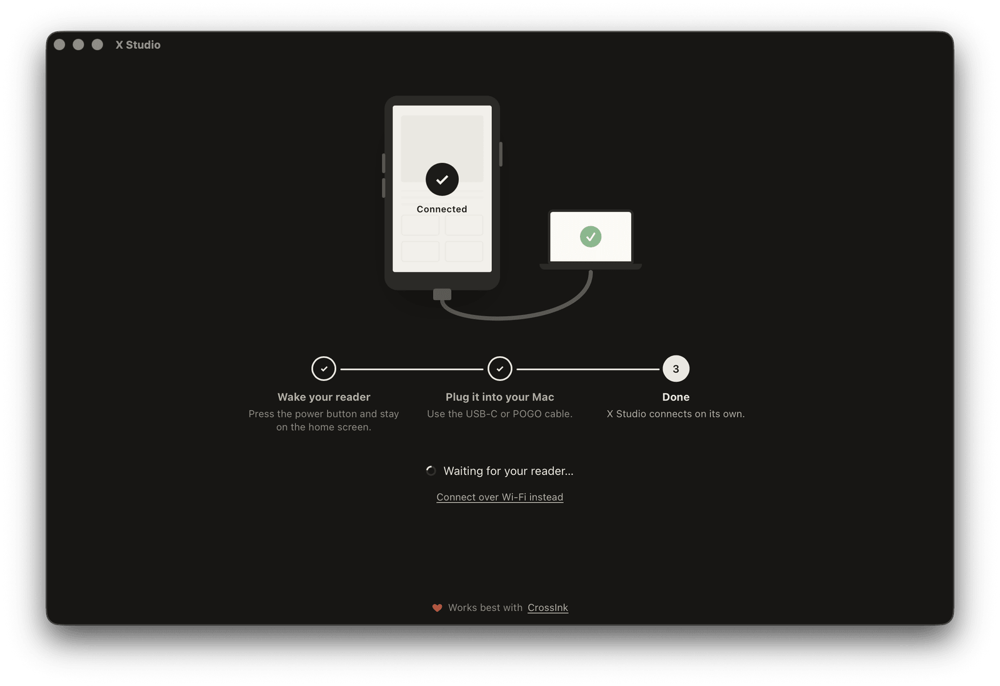

<p align="center">
  
</p>

<h1 align="center">X Studio</h1>

<p align="center">
  <b>Your Xteink e-reader, finally with a proper Mac app.</b><br>
  Books, covers, sleep screens and fonts — sorted, editable, one drag away.
</p>

<p align="center">
  <a href="https://github.com/billo32/x-studio/releases/latest"><b>Download for macOS</b></a> ·
  X4 · X4 Classic · X4 Pro · X3 · Sticky ·
  <a href="https://github.com/uxjulia/CrossInk">Works best with CrossInk ♥</a>
</p>

---

Plug in the reader and X Studio opens your shelf, not a file browser. Every book shows up with its
real cover, title, author and page count. Click one to fix the metadata or drop a new cover on it,
and see exactly how it will look on your reader's screen before you save.

## Why X Studio

- **A library, not a folder tree.** The SD card is sorted into Books, Sleep & boot screens, Fonts,
  Dictionaries and Other. Switch between a cover grid and a compact list, and search by title or author.
- **Covers that fit.** Drag an image onto a book's cover. The preview shows how it fills the screen
  of your model (480×800 or 528×792) — fill, fit or stretch — and X Studio bakes it to that size.
- **Fix messy metadata.** Edit title, author, language and series, or move the book to another folder.
  "Sapkovskiy_A._Vedmak6375365" becomes «Ведьмак» by Анджей Сапковский.
- **Real page counts.** Stable pages (1,500 characters, the same measure CrossInk and KOReader use),
  plus chapters and an estimated reading time, for every book on the card.
- **Reliable uploads.** Drop files anywhere in the window or press *Add…*. Batches go through one by
  one, and X Studio waits for the reader to be ready between files instead of failing halfway.
- **USB or Wi‑Fi.** Connects on its own over USB‑C or the POGO cable, or over the reader's
  File Transfer Wi‑Fi server — no setup, no drivers.
- **Native, small and private.** A signed and notarized Mac app built with Rust. Nothing leaves your
  computer; book info is cached locally so the second time is instant.

## Screenshots

<table>
  <tr>
    <td width="50%"></td>
    <td width="50%"></td>
  </tr>
  <tr>
    <td><b>Connect.</b> Wake the reader, plug it in — X Studio picks it up by itself.</td>
    <td><b>First scan.</b> Titles, authors and covers are read once, then cached.</td>
  </tr>
</table>

## Get it

1. Download the `.dmg` from [Releases](https://github.com/billo32/x-studio/releases/latest)
   (universal: Apple silicon and Intel, macOS 11 or later).
2. Drag **X Studio** to Applications and open it.
3. Wake your reader, stay on the home screen and plug it in.

USB transfers need the [CrossInk](https://github.com/uxjulia/CrossInk) firmware.
Upstream [CrossPoint](https://github.com/crosspoint-reader/crosspoint-reader) works over Wi‑Fi.

> X Studio is an independent project and is not affiliated with Xteink.

## Develop

```bash
npm install
npm run tauri dev
```

Requirements: Node 22, Rust stable, Xcode command line tools.

```bash
npm test                      # UI unit tests (Vitest)
cargo test --workspace        # protocol and book tests — no reader needed
npm run check                 # both, plus clippy
```

## Release (signed and notarized)

Needs a **Developer ID Application** certificate in the keychain.

```bash
cp signing.env.example signing.env   # once: notarization credentials (a notarytool keychain profile is simplest)
npm run release                      # signed + notarized .app and .dmg in target/release/bundle
```

Full release — version bump, tests, universal build, notarization, tag and GitHub Release:
double-click `Release.command`, or run `scripts/release.sh 0.2.0`. Artifacts land in `release/<tag>/`.
`scripts/notarize-release.sh <tag>` re-notarizes an existing release and replaces its files.

`npm run verify` checks the newest build the way Gatekeeper does — signature, hardened runtime,
stapled tickets, Gatekeeper verdict for the app, the disk image (also as a quarantined download)
and the app inside it, checksums and recent notarization history. Pass a path to check something
else: `scripts/verify-release.sh release/v0.2.0`.

Pushing a `v*` tag also builds a signed and notarized `.dmg` on GitHub Actions and attaches it to a
draft release; the required repository secrets are listed in `.github/workflows/release.yml`.

## Project layout

```
crates/x4-device/   reader transports, independent of Tauri
  src/usb.rs        CrossInk's binary CMND protocol over USB CDC serial
  src/wifi.rs       File Transfer server: HTTP :80, WebSocket uploads :81, UDP discovery :8134
  tests/            in-memory models of the firmware for both transports
crates/x4-books/    EPUB / FB2 / TXT metadata, stable pages, covers, EPUB rewriting
src-tauri/          Tauri commands, book cache, transfer queue
src/                UI (Svelte 5)
scripts/            build, notarization and release scripts
```

## How it talks to the reader

**USB** (`UsbSerialFileTransfer.cpp` in CrossInk): `CMND` + a command byte. Paths are a `u16 LE`
length plus UTF‑8 (≤ 255 bytes); sizes and CRC32s are `u32 LE`. Commands: `S` status, `A` list,
`K` mkdir, `W` write, `R` remove, `N` rename, `T` read. A write is `READY` → 256‑byte chunks,
each acknowledged with `0x06` → CRC32 → `OK`. The port also carries the firmware's log, so
non-protocol lines are skipped and `BUSY:` lines extend timeouts. File commands are accepted only
while the reader is on its home screen; the app waits for it to return there between files.

**Wi‑Fi** (`CrossPointWebServer.cpp`, `docs/webserver-endpoints.md`): uploads go over WebSocket
as `START:<name>:<size>:<dir>` → `READY` → 4 KB binary frames → `PROGRESS` / `DONE`.

A protocol log is written to `~/Library/Logs/dev.tls1.xstudio/usb.log`.

## Books

On connect the app scans the card and reads each book once in the background — title, author,
cover, stable pages (1,500 characters, as in CrossInk's optimizer and KOReader), chapters. Results
and files are cached in `~/Library/Caches/dev.tls1.xstudio/books`. Hidden folders (`.sleep`,
`.fonts`…) are only visible when *Show hidden files* is on in the reader's settings.

Saving an EPUB rewrites its package metadata and, if the cover was changed, bakes the cover to the
model's screen size (480×800 or 528×792) with the chosen fit.

## Roadmap

1. EPUB optimizer (images, chapter splitting) based on CrossInk's web optimizer
2. FB2 / TXT / DOCX → EPUB conversion (makes FB2 editable)
3. Sleep-screen generator (dithered BMP)
4. Local library for books that are not on the reader yet

## License

MIT
